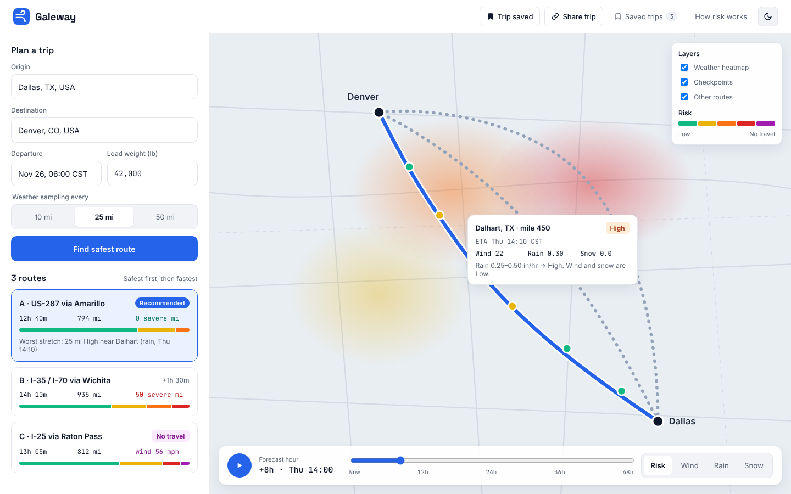

<p align="center">
  
  
</p>

<p align="center"><strong>Pick the safest way through the weather.</strong><br>
Weather-aware truck routing. Three truck-legal routes, forecast checked at every checkpoint at the hour the truck actually gets there, and one clear, explained recommendation.</p>

<p align="center">
  <a href="#">Live app</a> ·
  <a href="#">Video walkthrough</a> ·
  <a href="docs/README.md">Documentation</a> ·
  <a href="docs/02-domain/RISK_MODEL.md">Risk model</a>
</p>

> **Status: Phase 0 (skeleton).** The repo, tooling, CI and a deployable shell exist; trip planning is not built yet, so the sections below describe what Galeway will do. See the [roadmap](docs/10-planning/ROADMAP.md).
>
> Links marked `#` are filled in at release (see [Roadmap, Phase 7](docs/10-planning/ROADMAP.md#phase-7-release--walkthrough)).



---

## What it will do (planned)

A driver enters **origin, destination, departure time and load weight**. Galeway then:

1. Gets **3 truck routes** from TomTom's truck-aware routing, with the real load weight.
2. Places **checkpoints every 10, 25 or 50 miles** and works out the **ETA at each one**.
3. Pulls the **hourly forecast for that place at that ETA** (Open-Meteo) and classifies wind, rain and snow against the [risk and load rules](docs/02-domain/RISK_MODEL.md).
4. **Recommends a route**: fewest Severe miles, then fewest High miles, then lowest average risk, then shortest time. It explains which rule decided.
5. Shows everything on a **map**: routes, colored checkpoints, ETAs, route summaries, plus a **weather heatmap along the corridor with a 0–48 h forecast slider**.

Useful extras, kept small on purpose:

- **Share trip**: the URL holds the full state (trip, selected route, forecast hour, layer, map view), so a copied link opens exactly what you saw. See [URL state](docs/03-architecture/URL_STATE.md).
- **Saved trips**: kept in your browser (`localStorage`), no account needed. See [ADR-0007](docs/09-decisions/0007-saved-trips-in-localstorage.md).
- **Light and dark** themes, keyboard accessible, works on mobile.

## How the recommendation works (short version)

| Condition | Low | Moderate | High | Severe | No travel |
|---|---|---|---|---|---|
| Wind (mph, sustained) | < 25 | 25 – 34 | 35 – 44 | 45 – 54 | ≥ 55 |
| Rain (in/hr) | < 0.10 | 0.10 – < 0.25 | 0.25 – < 0.50 | 0.50 – 1.00 | > 1.00 |
| Snow (in/hr) | < 0.5 | 0.5 – < 1.0 | 1.0 – < 2.0 | 2.0 – 3.0 | > 3.0 |

Load rules: wind ≥ 55 mph is No travel for any load. 45–54 mph with more than 30,000 lb is No travel. 35–44 mph with more than 40,000 lb is Severe. Each checkpoint takes the worst of the three conditions. Every edge case (boundaries, units, time zones, missing data) is written down in the [Risk model](docs/02-domain/RISK_MODEL.md).

## Tech stack

| Layer | Choice | Why |
|---|---|---|
| Frontend | React 19.3 · TypeScript 6.0 (strict, [ADR-0010](docs/09-decisions/0010-typescript-6-and-eslint-9.md)) · Vite 8 · Tailwind CSS 4.3 · shadcn/ui (Radix) | Fast, accessible, typed |
| Routing (UI) | TanStack Router 1.170 (typed, validated search params) | URL is the app state ([ADR-0008](docs/09-decisions/0008-tanstack-router-and-maplibre-wrapper.md)) |
| Data | TanStack Query 5 · zod (planned) · API types generated from OpenAPI | One contract, checked at build time |
| Map | MapLibre GL JS (planned) · OpenFreeMap tiles · native heatmap layer | GPU rendering, $0, no key |
| Backend | Python 3.13 · Django 6.1 · Django Ninja 1.8 (async) · httpx (from Phase 2) | Typed, async calls to providers in parallel ([ADR-0001](docs/09-decisions/0001-django-ninja-over-drf.md)) |
| Cache / limits | Redis (Upstash free tier, from Phase 2) | Shared cache plus rate limiting |
| Providers | TomTom Routing + Search (truck mode) · Open-Meteo | Free, no card ([ADR-0003](docs/09-decisions/0003-tomtom-truck-routing.md), [ADR-0004](docs/09-decisions/0004-open-meteo-weather.md)) |
| Hosting | Render (API, Docker) · Cloudflare Pages (web) · Upstash (Redis) | All free tiers ([ADR-0009](docs/09-decisions/0009-free-tier-hosting.md)) |

## Repository layout

```text
galeway/
├── AGENTS.md            # rules for coding agents (and humans)
├── CLAUDE.md            # imports AGENTS.md
├── README.md            # you are here
├── backend/             # Django + Ninja API (Dockerized)
├── frontend/            # React + Vite SPA
├── docs/                # everything else, see docs/README.md
├── .github/workflows/   # CI, keep-warm ping
└── docker-compose.yml   # local Redis + API
```

## Run it locally

Full guide: [Local development](docs/08-operations/LOCAL_DEVELOPMENT.md).

```bash
# prerequisites: Docker, uv, Node (Active LTS) with pnpm; a free TomTom API key is needed from Phase 2
cp backend/.env.example backend/.env
cp frontend/.env.example frontend/.env
make setup
make dev                                    # API on :8000, web on :5173
```

## Quality

- **Tests**: pytest (+ Hypothesis) for the backend, Vitest + Testing Library + MSW for the frontend, Playwright + axe for end-to-end and accessibility. Coverage reports are produced in CI. See [Testing](docs/07-engineering/TESTING.md).
- **Gates**: lint, format, strict types, tests, coverage thresholds, bundle-size budget and dependency audit must pass before merge. See [Quality gates](docs/07-engineering/QUALITY_GATES.md).
- **SEO**: static meta, Open Graph/Twitter cards, JSON-LD, prerendered public pages, `noindex` on trip pages. See [SEO](docs/04-frontend/SEO.md).
- **Docs stay current**: every change updates the matching docs, this README and the [changelog](docs/10-planning/CHANGELOG.md); CI blocks changes that skip it ([AGENTS.md §9](AGENTS.md#9-keeping-docs-in-sync-mandatory-after-every-change)).
- **Security**: provider keys are kept on the server, rate limits, strict validation on both client and server, CSP and security headers, RFC 9457 error responses. See [Security](docs/03-architecture/SECURITY.md).

## Assumptions and limits

- Continental United States, imperial units.
- Driver hours-of-service breaks are not modeled. ETAs assume continuous driving at the provider's traffic-aware speeds.
- Weather is a forecast and can change. Every result shows when the forecast was issued.
- Authentication is out of scope on purpose ([ADR-0002](docs/09-decisions/0002-no-authentication.md)).

## Documentation

Start at **[docs/README.md](docs/README.md)**. It covers product, domain rules, architecture, API, design system and mockups (light and dark), engineering standards, operations, decision records and the roadmap.
