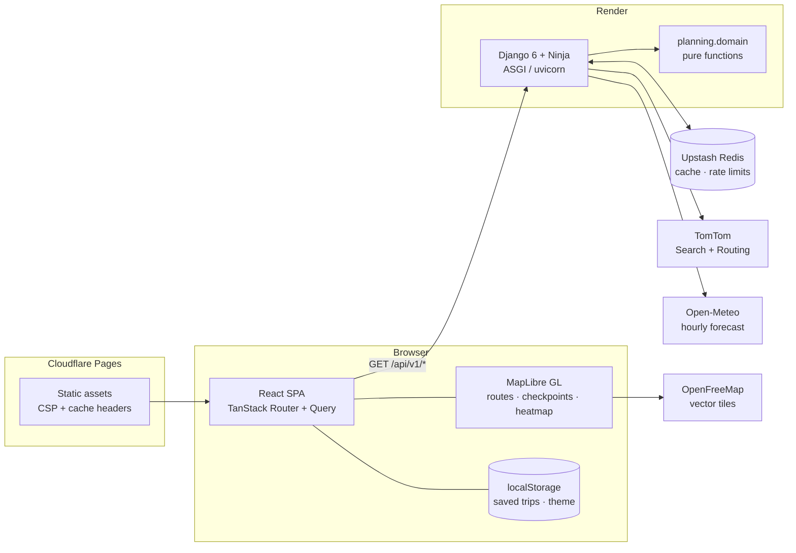
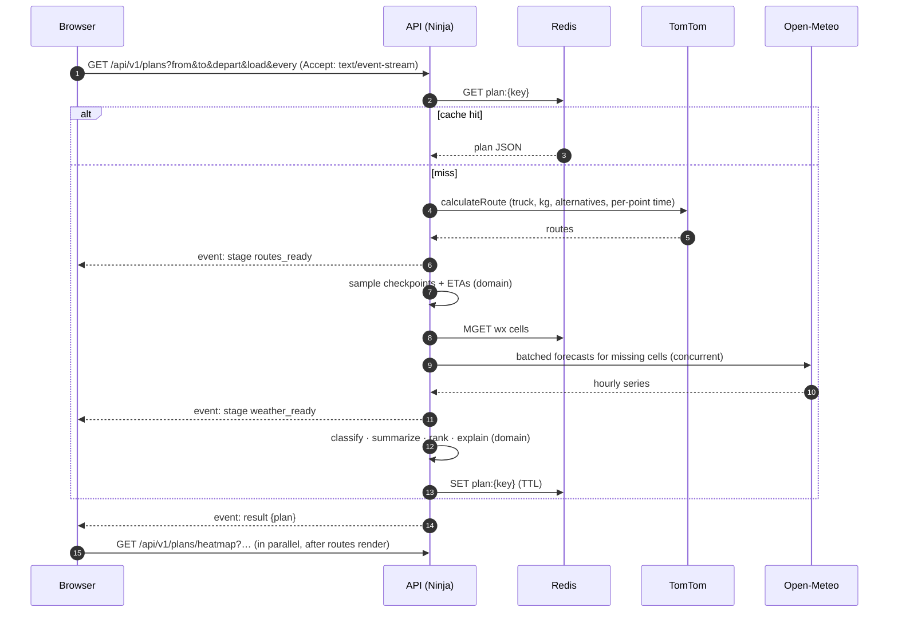

# Architecture

## 1. System overview

**Key properties**

- **Stateless backend, no database.** Every request carries the full trip in its query string. Results are recomputable and cacheable by key ([ADR-0005](../09-decisions/0005-url-as-source-of-truth.md)).
- **Functional core, imperative shell.** `planning/domain` is pure and does the logic. `planning/service.py` does the I/O and calls the domain. Ninja routers do HTTP only.
- **One typed contract.** Ninja generates OpenAPI. `make api-types` generates `frontend/src/lib/api/schema.d.ts`, so the build fails if frontend and backend drift.
- **Keys stay server-side.** The browser talks only to our API and to the tile CDN.

## 2. Request flow: planning a trip

The same `GET /api/v1/plans` returns plain JSON when `Accept: application/json`. That form is cacheable by CDN and browser and is used for direct links and refetches. SSE progress is a progressive enhancement; if it fails, the client falls back to JSON with an indeterminate loader.

## 3. Modules

| Module | Responsibility | Must not |
|---|---|---|
| `galeway.api` | Routers, request/response schemas, validation, problem+json errors, throttles, cache headers | contain business logic |
| `galeway.planning.domain` | Units, risk, sampling, ETA, ranking, explanation, heatmap grid math | import Django, httpx, Redis, or read the clock |
| `galeway.planning.service` | Orchestrate: geocode → route → sample → weather → classify → rank; cache; progress events | know about HTTP request objects |
| `galeway.providers` | TomTom and Open-Meteo adapters, shared HTTP client (timeouts, retries, circuit breaker), cache helpers | leak provider JSON shapes outside |
| `galeway.core` | Settings helpers, structured logging, request id, health check | |

The clock is injected (`now: datetime` parameter) so domain tests are deterministic.

## 4. Failure modes

| Failure | Behavior | User sees |
|---|---|---|
| TomTom down / 5xx | 2 retries with jittered backoff, then 502 `PROVIDER_UNAVAILABLE` | Blocking error card with Retry and a reference id |
| TomTom quota exhausted (403/429) | No retry; 503 `ROUTING_QUOTA` | "Routing is busy right now, try again shortly." |
| Open-Meteo partial failure | Affected checkpoints `NO_DATA`; plan still returned with `PARTIAL_FORECAST` warning | Amber banner; unknown miles counted, never safe |
| Open-Meteo fully down | 502 `WEATHER_UNAVAILABLE`, routes still returned in the error payload | "Your routes are ready, but we couldn't load the forecast." |
| Redis down | Fail open: in-process TTL cache + in-process rate limiter; log error | Nothing (slightly slower) |
| Rate limit hit | 429 with `Retry-After` | Toast with countdown and Retry |
| Cold start (free tier) | Client pre-warms `/api/v1/health` on load | After 3 s: "Starting up the server…" banner |
| Invalid share link | Client-side zod parse fails | 404 page: "This road doesn't go anywhere" |
| Unexpected exception | 500 problem+json with request id; full trace in logs only | Error card with reference id; error boundary for render errors |

## 5. Cross-cutting docs

[API](API.md) · [URL state](URL_STATE.md) · [Caching](CACHING.md) · [Security](SECURITY.md) · [Performance](PERFORMANCE.md) · [Frontend](../04-frontend/FRONTEND.md) · [Backend](../05-backend/BACKEND.md)
