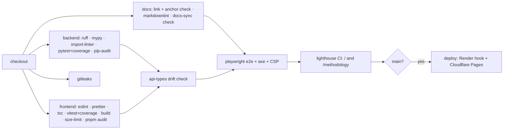

# Quality gates

Nothing merges or deploys unless every gate is green. `make check` runs the same gates locally.

## 1. CI pipeline (`.github/workflows/ci.yml`)

| Gate | Fails when |
|---|---|
| Lint / format | any ruff, ESLint or Prettier error |
| Types | any mypy (strict) or `tsc` error |
| Architecture | `planning.domain` imports Django/httpx/redis (import-linter) |
| Tests | any failure |
| Coverage | domain < 95% (enforced from Phase 1, when the domain has code), backend < 85%, frontend < 80%, `lib/` < 90% |
| API contract | regenerated `schema.d.ts` differs from the committed one |
| Bundle | initial JS > 180 KB gzip (`size-limit`, wired in Phase 0) or map chunk > 300 KB gzip (added with the map in Phase 3) |
| E2E | any failure, any serious/critical axe issue, any CSP violation |
| Lighthouse | SEO < 100, Performance/Accessibility/Best Practices < 95 on `/` and `/methodology` |
| Security | `pip-audit`/`pnpm audit` high or critical, any `gitleaks` finding, any CodeQL alert (Python + TypeScript; free for public repos) |
| API fuzzing | Schemathesis finds a 500, a non-problem+json error, or a response that doesn't match the schema |
| Docs: links | any broken relative link or heading anchor in any `.md` (`lychee --offline` or the repo script) |
| Docs: lint | `markdownlint` errors |
| Docs: sync | code changed in a mapped area (see below) but no doc in that area changed, and the PR doesn't carry the `no-docs-needed` label with a reason |
| Docs: changelog | `CHANGELOG.md` has no new line under `Unreleased` for a `feat`/`fix`/`perf`/`refactor` change |

**Docs-sync mapping** (`.github/scripts/check_docs_sync.py`): if a PR touches a code path on the left, at least one doc on the right must change too.

| Code path | Docs |
|---|---|
| `backend/galeway/planning/domain/**` | `docs/02-domain/*` |
| `backend/galeway/providers/**` | `docs/02-domain/ROUTING_AND_WEATHER.md`, `docs/03-architecture/CACHING.md` |
| `backend/galeway/api/**` | `docs/03-architecture/API.md` |
| `backend/config/settings/**`, `.env.example` files | `docs/05-backend/BACKEND.md`, `docs/08-operations/*` |
| `frontend/src/lib/url-state/**`, `frontend/src/routes/**` | `docs/03-architecture/URL_STATE.md` |
| `frontend/src/features/**`, `frontend/src/styles/**` | `docs/04-frontend/*` or `docs/06-design/*` |
| `frontend/public/**`, `index.html` | `docs/04-frontend/SEO.md` or `docs/03-architecture/SECURITY.md` |
| `Makefile`, `docker-compose.yml`, `.github/workflows/**` | `docs/08-operations/*`, `docs/07-engineering/QUALITY_GATES.md` |
| `package.json` or `pyproject.toml` dependency changes | `README.md` tech stack (if user-visible) or an ADR (if structural) |

The e2e, Lighthouse and Schemathesis jobs are added with the code they test (Phase 2 and Phase 6). Docs-sync runs against the PR base (`BASE_REF`) and the `no-docs-needed` label sets `NO_DOCS_NEEDED=1`. Locally it compares the working tree with `HEAD`. The Claude Code Stop hook in `.claude/settings.json` runs `make docs-check` so an agent cannot finish with stale docs.

CI caches the uv and pnpm stores. Jobs run in parallel where possible. Actions are pinned to SHAs; workflow `permissions` are minimal.

## 2. Pre-commit hooks

`ruff` (fix + format), `prettier`, `eslint --fix` on staged files, `gitleaks protect --staged`, end-of-file/whitespace fixers, and a commit-msg check for Conventional Commits.

## 3. Definition of done

See [AGENTS.md §8](../../AGENTS.md#8-definition-of-done-every-change). Plus, before release:

- [ ] All 9 screens match the mockups in both themes and at 390 px
- [ ] Every state in `06-states-errors-toasts.png` can be triggered (fixtures or dev toggles)
- [ ] Share links tested on a second device
- [ ] Production smoke test: plan a real trip, share it, save it, reload
- [ ] README links (live app, walkthrough video) filled in; coverage numbers updated
